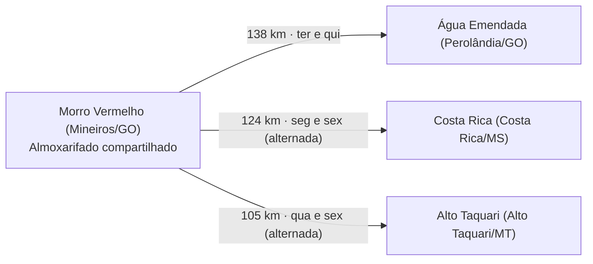

# Diagnóstico do abastecimento atual de materiais MRO 

A Sprint 1 já consegue descrever a rede de oito usinas, o piloto do Polo Norte e as bases de estoque e consumo. Ainda não consegue dizer quanto custa a operação atual: esses gastos precisam vir da Atvos ou ser estimados com premissas claras.

## 1. Objetivo, escopo e fontes

O objetivo da Sprint 1 é descrever como funciona hoje o abastecimento de materiais de manutenção, reparo e operação (MRO) nas unidades agroindustriais da Atvos. Esse retrato serve de base para comparar, nas próximas sprints, a operação atual com dois cenários: um centro de distribuição (CD) centralizado e um modelo híbrido, com parte do estoque no CD e parte nas usinas.

O documento de entregáveis define seis grupos de materiais de interesse: **pneus, filtros, lubrificantes, rolamentos, mangueiras e peças de desgaste agrícola**.

Este relatório junta dois tipos de fonte, que devem ser tratados de forma diferente:

| Tipo | Fonte | O que traz |
| --- | --- | --- |
| Dados da Atvos | Planejamento de Materiais — aba Consolidado | Código do centro, usina, cidade/UF, material, grupo de análise, fornecedor e sua localização, prazo médio de entrega, consumo e posição de estoque. Alguns campos de fornecedor estão vazios. |
| Dados da Atvos | Base de Planejamento de Materiais — abas Base_Consumo e Base_Estoque_Atual | Consumo mensal por material e centro; quantidade e valor do estoque por material, centro e depósito. |
| Dados da Atvos | Apresentação Estoque Compartilhado — slides 4 a 8 | Diagnóstico da Atvos, piloto do Polo Norte, distâncias, cronograma de entregas e valor dos materiais movimentados. |
| Referências externas | Site da Atvos, estudos de caso (CSN, usina em MS), tabela ANTT, pesquisas salariais e de custo de estoque | Localização confirmada, fluxo típico de compras, faixas de custo para montar cenários. |

Regra do relatório: números da Atvos e cálculos da equipe são resultados; referências externas servem apenas para montar cenários e nunca devem aparecer como dado da Atvos. Os totais de duplicidade e baixo giro citados aqui são os reportados pela Atvos, e ainda precisam ser recalculados no recorte do projeto.

## 2. Localização das unidades

As oito usinas ficam em quatro estados (GO, MT, MS e SP) e se organizam em dois polos mais a unidade isolada de Pontal. A aba Consolidado liga o código do centro à usina e ao município, o que é essencial porque as bases de estoque e consumo identificam a unidade só pelo código. A lista bate com o site oficial da Atvos.

| Código do centro | Unidade | Sigla | Município/UF | Grupo geográfico |
| --- | --- | --- | --- | --- |
| 1032 | Morro Vermelho | UMV | Mineiros/GO | Polo Norte (centro do piloto) |
| 1031 | Água Emendada | UAE | Perolândia/GO | Polo Norte |
| 1034 | Costa Rica | UCR | Costa Rica/MS | Polo Norte |
| 1035 | Alto Taquari | UAT | Alto Taquari/MT | Polo Norte |
| 1024 | Rio Claro | URC | Caçu/GO | Polo Norte (mais afastada) |
| 1017 | Santa Luzia | USL | Nova Alvorada do Sul/MS | Cluster Sul |
| 1020 | Eldorado | UEL | Rio Brilhante/MS | Cluster Sul |
| 1013 | Conquista do Pontal | UCP | Mirante do Paranapanema/SP | Isolada |

**Distâncias documentadas (slides 5 e 6 do PPT, piloto Polo Norte):** de Morro Vermelho até Água Emendada são 138 km, até Costa Rica 124 km e até Alto Taquari 105 km.

**Distâncias estimadas (linha reta entre centros das cidades):**

- Cluster Norte: Morro Vermelho, Água Emendada, Alto Taquari e Costa Rica ficam a 50–160 km entre si. Rio Claro fica a 150–240 km.
- Cluster Sul: Eldorado e Santa Luzia ficam a cerca de 40 km uma da outra.
- Pontal: cerca de 270 km do cluster Sul e 420–530 km do Norte.
- Entre os dois clusters: cerca de 350–540 km.

A distância real por estrada costuma ser 20–30% maior que a linha reta. Antes de usar no relatório final, as rotas devem ser conferidas no Google Maps. Também falta a Atvos confirmar se as oito unidades formam o escopo do estudo.

## 3. Caminho dos materiais entre fornecedores, estoques e unidades

O único trecho do fluxo físico bem documentado é o piloto de estoque compartilhado do Polo Norte. Para o restante da rede, só há o modelo típico do setor, que ainda precisa ser confirmado com a Atvos.

**O que as bases mostram.** A aba Consolidado associa fornecedores a materiais e centros. Quando preenchidos, os campos de cidade, estado e prazo médio de entrega mostram de onde vem o material e quanto demora. Mas esses registros não dizem onde a mercadoria foi recebida nem se passou por uma transferência antes de chegar à usina que a usou.

**Modelo típico do setor (referência externa).** Em estudos de usinas e indústrias, o fluxo costuma seguir esta ordem:

1. O usuário pede o material.
2. O estoque gera a requisição.
3. Compras negocia com fornecedores cadastrados e emite o pedido (na CSN, o pedido é gerado no SAP).
4. O fornecedor entrega no almoxarifado.
5. O almoxarifado repassa ao requisitante.

Um estudo de usina em MS encontrou dois tipos de compra: recorrentes, com estoque mínimo e ponto de pedido, e esporádicas, para materiais específicos. É preciso perguntar à Atvos se o fluxo deles é esse e se cada unidade compra sozinha ou se há compra centralizada.

**Piloto do Polo Norte (documentado no PPT).** Morro Vermelho funciona como ponto central de abastecimento sob demanda para Água Emendada, Costa Rica e Alto Taquari, usando o veículo de entrega do almoxarifado compartilhado (slide 8).

*Fase 1 concluída segundo o PPT; expansão para as oito unidades prevista. Situação atual a confirmar.*

| Dia | Rota (slide 8) |
| --- | --- |
| Segunda | Morro Vermelho → Costa Rica |
| Terça | Morro Vermelho → Água Emendada |
| Quarta | Morro Vermelho → Alto Taquari |
| Quinta | Morro Vermelho → Água Emendada |
| Sexta | Morro Vermelho → Costa Rica ou Alto Taquari, alternando |

**Por que isso importa.** Se o piloto ainda estiver ativo, ele faz parte do cenário atual. Nesse caso, um novo CD deve ser avaliado pelo ganho *a mais* que traz sobre o que a Atvos já centralizou. Falta confirmar se o cronograma continua valendo, quais materiais passam pelo estoque compartilhado e como as outras usinas são abastecidas.

## 4. Estoque por material e almoxarifado

As bases já permitem levantar o estoque de cada almoxarifado e cruzá-lo com o consumo, desde que a equipe filtre os materiais do escopo e una as bases pelo par centro + código do material.

**O que cada aba traz:**

- **Base_Estoque_Atual:** material, centro, depósito, unidade de medida, quantidade e valor em reais. Mostra onde está concentrado o valor do estoque. Atenção: a aba inclui itens fora do escopo, como fertilizantes e diesel. Somar a base inteira daria um valor que não é o estoque MRO do projeto.
- **Base_Consumo:** histórico mensal por centro e código do material.

**Cuidado no cruzamento.** O saldo vem por depósito, mas o consumo vem por centro (usina). A equipe pode mostrar o saldo de cada depósito separado, mas deve somar os saldos do mesmo material no centro antes de comparar com o consumo daquele centro. Assim não se atribui a um depósito um consumo que só existe para a usina inteira.

**Passos para um cruzamento confiável:**

1. **Filtrar os materiais do projeto.** Validar se os grupos das bases correspondem aos seis grupos do documento de entregáveis.
2. **Conferir os depósitos.** Identificar quais códigos são os almoxarifados que entram no levantamento.
3. **Fixar as datas de referência.** Registrar a data do saldo e o último mês completo de consumo. Um mês sem dados completos não é um mês sem movimento.
4. **Conferir as unidades de medida.** Saldo e consumo precisam estar na mesma unidade para cada material.

Com estoque e consumo cruzados, dá para encontrar itens repetidos entre unidades e itens parados (próxima seção).

## 5. Estoques repetidos e materiais de baixo consumo

Segundo a própria Atvos, quase metade dos itens com reposição ativa (9.741 de 19.614) está em mais de duas unidades. Esses números são do diagnóstico da empresa e devem ser citados com esse recorte.

**Oito unidades (slide 4):**

| Indicador reportado pela Atvos | Resultado |
| --- | --- |
| Itens em estoque nas oito unidades com reposição ativa | 19.614 |
| Itens presentes em mais de duas unidades | 9.741 |
| Itens de baixo giro identificados no grupo | 2.877 |

**Polo Norte (slide 7), a apresentar separado:** 1.374 itens analisados, com R$ 3,896 milhões em estoque. Desse total, R$ 473 mil foram apontados como *potencial* para venda de ativos. Isso é um potencial, não uma venda feita nem uma economia recorrente.

**Como recalcular a repetição no recorte do projeto:** contar em quantos centros diferentes cada material tem saldo positivo. Se o material aparece em dois depósitos da mesma usina, conta como um centro. Para seguir o critério do PPT, destacar os materiais com saldo em mais de dois centros.

**Como analisar baixo consumo:**

1. Separar materiais com saldo positivo e sem consumo registrado dos que foram consumidos em poucos meses.
2. Antes de classificar, definir a janela de meses completos e conferir lacunas no histórico.
3. Perguntar se a Atvos já usa um critério próprio de baixo giro.
4. Informar quantos itens entram no critério e quanto valem em estoque.

**Cuidado na leitura.** Material repetido em várias usinas é uma oportunidade de análise, não prova de excesso. Um item de baixo consumo pode ser essencial numa manutenção de emergência e precisar ficar na usina. Quando houver dados, a avaliação deve considerar a criticidade do item e o tempo para repô-lo ou transferi-lo.

## 6. Custos atuais de armazenagem, transporte e equipe

As fontes da Atvos trazem o valor dos materiais, mas não o custo de operar o abastecimento. Esse custo deve ser pedido à Atvos; enquanto não chega, as referências de mercado abaixo servem só para montar cenários.

**Três informações que não podem ser confundidas:**

| Informação | O que significa | Situação |
| --- | --- | --- |
| Valor dos materiais em estoque | Valor dos materiais parados nos depósitos numa data | Base_Estoque_Atual traz o valor em reais. O total do projeto depende do filtro de materiais e depósitos. |
| Valor dos materiais movimentados | Valor das mercadorias que circulam num período | Slide 8 estima R$ 298 mil/mês, com base em notas fiscais. É valor de mercadoria, não custo. |
| Custo da operação | Gasto para armazenar, transportar, movimentar e manter a equipe | Não encontrado nas fontes. Pedir à Atvos ou estimar com premissas explícitas. |

**O que pedir para cada custo:**

- **Armazenagem:** gasto com os almoxarifados de MRO (espaço, manutenção, serviços de operação).
- **Transporte:** frete contratado ou custo do veículo próprio nas rotas (combustível, manutenção), e quem paga o frete (fornecedor ou Atvos).
- **Equipe:** gasto com quem recebe, armazena, separa e expede.

**Referências de mercado para cenários (não são dados da Atvos):**

| Custo | Referência | Como usar |
| --- | --- | --- |
| Manutenção de estoque | 20% a 30% ao ano sobre o estoque médio (exemplos de mercado; não existe percentual padrão) | Taxa = (custo de capital + armazenagem + risco) ÷ estoque médio |
| Frete rodoviário | Piso ANTT para carga geral: R$ 4,00 a R$ 9,25 por km, conforme os eixos, mais R$ 436 a R$ 872 de carga e descarga | Distância × custo por km + carga e descarga. É um piso: o frete real tende a ser maior. |
| Almoxarife | Média de R$ 2.139/mês no Brasil em 2026; vaga recente em Mineiros oferecia R$ 2.345,64 | Somar encargos, em geral 60% a 80% sobre o salário (suposição) |

Exemplo de uso: uma viagem Morro Vermelho → Água Emendada (138 km) custaria, no piso ANTT, entre R$ 988 (138 × 4,00 + 436) e R$ 2.149 (138 × 9,25 + 872) por trecho. Isso é um cenário, não o custo real da rota, que usa veículo próprio.

**Regras para os valores:** todos no mesmo período de referência. Se almoxarifado, equipe ou veículo forem compartilhados com outras operações, registrar como foi calculada a parte do MRO. Verificar se algum valor já inclui equipe ou transporte, para não contar a mesma despesa duas vezes.

## Fontes

**Dados da Atvos:** Planejamento de Materiais (aba Consolidado); Base de Planejamento de Materiais (abas Base_Consumo e Base_Estoque_Atual); Apresentação Estoque Compartilhado (slides 4 a 8).

**Referências externas:** Atvos – Nossas Unidades; Loggi – Custo de estoque; Mundo Logística – reajuste do piso ANTT; Portal do Trânsito – cálculo do piso; Portal Salário – Almoxarife; InfoJobs – Almoxarife Mineiros; ABM – Gestão MRO na CSN; UFMS – Estoque de manutenção em usina. Os documentos de origem não traziam os links; vale incluí-los antes da entrega.