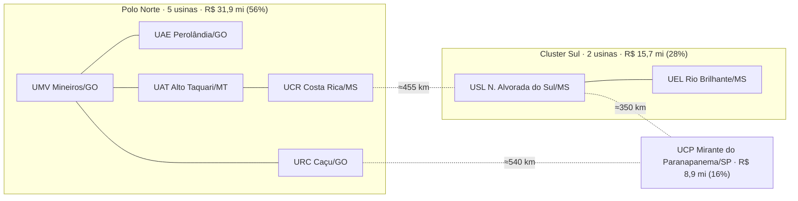

# 2. Comparação de regiões para o CD

> **Escopo e premissas (Sprint 2).** O recorte desta comparação tem quatro grupos de materiais: **pneus, rolamentos e retentores, filtros e lubrificantes**. As distâncias usam a sede dos municípios e devem ser refeitas com a localização exata das usinas assim que a Atvos confirmar.

## 2.1. Objetivo e perguntas a responder

Esta etapa compara poucas regiões candidatas para receber o centro de distribuição (CD) de materiais MRO. Em cada região, responde a quatro perguntas:

1. **Por que esta região entrou na análise?** Motivo da escolha e das exclusões.
2. **Como ela se conecta à rede?** Distâncias, acesso às unidades, proximidade dos fornecedores e estrutura de transporte.
3. **Dá para operar um CD ali?** Condições para instalar, receber e distribuir os materiais.
4. **O que se ganha e o que se arrisca?** Vantagens, dificuldades e riscos.

A comparação alimenta a planilha de viabilidade (custos de transporte e de instalação por região) e a comparação entre situação atual, CD centralizado e modelo híbrido.

## 2.2. Recorte dos dados: pneus, rolamentos, filtros e lubrificantes

A Sprint 1 trabalhou com seis grupos (pneus, filtros, lubrificantes, rolamentos, mangueiras e peças de desgaste agrícola). **Nesta comparação de regiões, o recorte foi reduzido a quatro grupos:** pneus, rolamentos e retentores, filtros e lubrificantes. Mangueiras e peças de desgaste agrícola ficam fora. Os pesos de cada usina e de cada fornecedor foram recalculados só com esses materiais.

**Como o recorte foi montado.** O método é o mesmo do [Mapeamento de Fornecedores](../001_Diagnostico_Abastecimento/Mapeamento_Fornecedores.md), aplicado à aba Consolidado do Planejamento de Materiais:

- **Grupo:** definido pela palavra inicial da descrição: PNEU ou câmara de ar, escrita na base como CAMARA AR ou CAM AR (pneus); FILTRO ou ELEMENTO (filtros); ÓLEO, GRAXA, FLUIDO ou ADITIVO (lubrificantes); ROLAMENTO, RETENTOR ou MANCAL (rolamentos e retentores).
- **Valor de consumo 2025:** quantidade consumida em 2025 × custo unitário do material (mediana de Estoque R$ ÷ Estoque Qtd). É uma **estimativa**, não o gasto real de compra.
- **Fornecedor:** combinação de nome e cidade, como na Sprint 1.

**Tabela 2.1 – Panorama do recorte**

| Grupo | Materiais | Consumo estimado 2025 | Estoque atual | Cobertura estimada | Fornecedores | Valor sem fornecedor identificado |
|---|---:|---:|---:|---:|---:|---:|
| Lubrificantes | 211 | R$ 23,6 mi (42%) | R$ 5,1 mi | 2,6 meses | 25 | R$ 9,9 mi (42%) |
| Pneus | 125 | R$ 14,7 mi (26%) | R$ 4,5 mi | 3,7 meses | 5 | R$ 0,1 mi (0,5%) |
| Filtros | 787 | R$ 12,1 mi (21%) | R$ 4,6 mi | 4,5 meses | 53 | R$ 1,8 mi (15%) |
| Rolamentos e retentores | 1.121 | R$ 6,0 mi (11%) | R$ 3,8 mi | 7,5 meses | 60 | R$ 0,5 mi (9%) |
| **Total** | **2.244** | **R$ 56,5 mi** | **R$ 18,0 mi** | **3,8 meses** | **85 distintos** | **R$ 12,3 mi (22%)** |

*Fonte: Atvos, Planejamento_Materiais, aba Consolidado (5.426 registros unidade × material, 8 unidades). Cobertura = estoque ÷ consumo estimado × 12. Um mesmo fornecedor pode atender mais de um grupo, por isso o total de fornecedores distintos (85) é menor que a soma.*

**Conciliação com a Sprint 1.** Lubrificantes (211 materiais, R$ 23,6 mi) e rolamentos (1.121, R$ 6,0 mi) batem com o Mapeamento. Pneus batem em valor (R$ 14,7 mi), fornecedores e participações, mas o recálculo encontrou 125 materiais contra 119, provavelmente pela abreviação "CAM AR". Em filtros, o recálculo encontrou 787 materiais e R$ 12,1 mi, contra 751 e R$ 11,4 mi. As duas diferenças devem ser conciliadas pela equipe; nenhuma altera a ordem das regiões.

**O que o recorte muda na análise de regiões**

| Grupo | Como o material se movimenta | Encaixe com um CD |
|---|---|---|
| **Pneus** | Cinco fornecedores, todos em SP (Bridgestone em Santo André, Yokohama em Barueri, Titan e Master em São Paulo, Grunner em Lençóis Paulista), todos atendendo as 8 usinas. Material volumoso, com *lead time* mediano de 19 a 38,5 dias. A Atvos citou os pneus como o "grande desafio": fornecedor centralizado e transportadora que consolida em Ribeirão Preto e redistribui por Itumbiara. | **Alto para consolidar a entrada.** Fornecedor concentrado e longe das usinas é o caso típico de ganho com carga consolidada. Exige muito espaço de armazenagem. |
| **Rolamentos e retentores** | Muitos itens, alto valor unitário, baixo giro e alta criticidade (exemplo da Atvos: rolamento de ~R$ 40 mil com 40 dias de prazo do fabricante). Têm a maior cobertura de estoque do recorte (7,5 meses). | **Alto.** Estoque repetido entre usinas e item crítico de baixo giro são exatamente o que um CD compartilhado resolve. |
| **Filtros** | Alto giro e consumo semanal. Fornecedores pulverizados, com regionais em Dourados e Goiânia. | **Parcial.** A Atvos indicou que filtros de alto giro devem ficar na usina (estoque do fornecedor faturado no consumo). O CD faz sentido só para filtros de baixo giro. |
| **Lubrificantes** | 42% do valor do recorte. Fornecedor praticamente único (Petronas, Contagem/MG, 93% do valor identificado). Granel e tambores, com exigências ambientais de armazenagem. | **A testar.** O fornecedor pode continuar entregando carga cheia direto nas usinas. O CD pode atender só embalagens menores (graxas, fluidos). |

Por isso, além do cálculo com os quatro grupos, a seção 2.5 testa a sensibilidade **só com rolamentos**, **só com pneus** e **sem lubrificantes**.

## 2.3. Método

O caminho proposto pela equipe é **localizar as unidades → medir as distâncias entre elas → formar grupos → cruzar com os fornecedores**. Ele foi mantido como espinha dorsal, com cinco complementos:

| # | Complemento | Por quê |
|---|---|---|
| 1 | **Ponderar as distâncias pelo consumo de cada unidade** nos quatro grupos | Uma usina que consome R$ 9 mi/ano pesa mais na decisão do que uma que consome R$ 4 mi. |
| 2 | **Separar o fluxo de entrada (fornecedor → CD) do fluxo de saída (CD → usinas)** | A entrada é consolidada e menos frequente (carga cheia), e a saída é frequente e fracionada. Um CD perto das usinas e um CD perto dos fornecedores resolvem problemas diferentes. |
| 3 | **Testar um, dois e três polos** (p-mediana) | As oito usinas formam um arco de cerca de 750 km. O teste indica quantos polos a rede pede antes de escolher a cidade. |
| 4 | **Usar o tributário como filtro desde o início** | A tentativa anterior de armazém em Mineiros parou por questão tributária e de transporte (reunião com a Atvos). A raiz de CNPJ e o estado de cada unidade podem tornar uma região inviável, mesmo que ela seja a melhor em distância. |
| 5 | **Medir distância por estrada, não em linha reta** | A Sprint 1 usou linha reta (+20–30%). Aqui as distâncias e os tempos de viagem são rodoviários. |

**Ferramentas e premissas do cálculo**

- **Localização:** sede municipal de cada usina, fornecedor e cidade candidata (OpenStreetMap/Nominatim, nov. 2026).
- **Distâncias e tempos:** rota de carro mais rápida no OSRM (Open Source Routing Machine) sobre a malha do OpenStreetMap. Caminhão demora mais: o tempo serve para comparar regiões, não para planejar rotas.
- **Peso das unidades:** consumo estimado de 2025 nos quatro grupos (Tabela 2.2; total de R$ 56,5 mi).
- **Peso dos fornecedores:** valor estimado de cada cidade fornecedora nos quatro grupos (37 cidades; R$ 44,2 mi com fornecedor identificado). Concessionárias de máquinas ficam fora: segundo a Atvos, já têm lojas a menos de 100 km das usinas e boa distribuição própria.

**Limite importante.** As usinas ficam na zona rural, não na sede do município. A comparação com as rotas reais do piloto do Polo Norte (slides 5 e 6 do PPT da Atvos) mostra diferenças de até 67 km:

| Trecho | PPT Atvos (rota real) | Cálculo entre sedes municipais | Diferença |
|---|---:|---:|---:|
| Morro Vermelho → Água Emendada | 138 km | 71 km | −67 km |
| Morro Vermelho → Costa Rica | 124 km | 172 km | +48 km |
| Morro Vermelho → Alto Taquari | 105 km | 143 km | +38 km |

Por isso os números deste documento servem para **ordenar e pré-selecionar regiões**, não para calcular o frete final. A coordenada de cada usina é a primeira pendência (seção 2.11).

## 2.4. Localização das unidades e distâncias entre elas

**Tabela 2.2 – Unidades e consumo estimado 2025 no recorte (R$ mi)**

| Sigla | Unidade | Município/UF | Pneus | Rolamentos | Filtros | Lubrificantes | **Total** | Estoque atual | Grupo geográfico |
|---|---|---|---:|---:|---:|---:|---:|---:|---|
| UCP | Conquista do Pontal | Mirante do Paranapanema/SP | 2,28 | 0,77 | 2,11 | 3,70 | **8,86** | 2,36 | Isolada |
| USL | Santa Luzia | Nova Alvorada do Sul/MS | 2,21 | 1,31 | 1,85 | 3,44 | **8,82** | 3,04 | Cluster Sul |
| UCR | Costa Rica | Costa Rica/MS | 1,80 | 0,82 | 1,82 | 4,29 | **8,74** | 2,30 | Polo Norte |
| URC | Rio Claro | Caçu/GO | 3,25 | 0,87 | 1,18 | 2,34 | **7,64** | 2,31 | Polo Norte (mais afastada) |
| UMV | Morro Vermelho | Mineiros/GO | 2,21 | 0,69 | 1,51 | 2,82 | **7,23** | 1,99 | Polo Norte (hub do piloto) |
| UEL | Eldorado | Rio Brilhante/MS | 1,21 | 0,80 | 1,53 | 3,35 | **6,88** | 2,91 | Cluster Sul |
| UAT | Alto Taquari | Alto Taquari/MT | 0,99 | 0,38 | 1,19 | 2,05 | **4,61** | 1,57 | Polo Norte |
| UAE | Água Emendada | Perolândia/GO | 0,77 | 0,41 | 0,94 | 1,57 | **3,69** | 1,50 | Polo Norte |
| | **Total** | | **14,73** | **6,05** | **12,13** | **23,56** | **56,46** | **17,99** | |

*UCP, USL e UCR estão praticamente empatadas como maiores consumidoras (R$ 8,7–8,9 mi). Rio Claro é a maior consumidora de pneus (R$ 3,3 mi, 22% do grupo).*

**Tabela 2.3 – Distância rodoviária entre unidades (km, entre sedes municipais)**

| De \ Para | UMV | UAE | UAT | UCR | URC | USL | UEL | UCP |
|---|---:|---:|---:|---:|---:|---:|---:|---:|
| **UMV** | — | 71 | 143 | 172 | 222 | 605 | 650 | 747 |
| **UAE** | 72 | — | 206 | 238 | 188 | 698 | 743 | 716 |
| **UAT** | 113 | 207 | — | 89 | 347 | 543 | 588 | 720 |
| **UCR** | 172 | 238 | 89 | — | 268 | 455 | 500 | 640 |
| **URC** | 223 | 189 | 347 | 267 | — | 646 | 691 | 542 |
| **USL** | 604 | 698 | 543 | 454 | 645 | — | 46 | 349 |
| **UEL** | 650 | 744 | 588 | 500 | 691 | 47 | — | 391 |
| **UCP** | 747 | 717 | 720 | 640 | 542 | 356 | 398 | — |

*Pequenas diferenças entre ida e volta vêm de mãos de direção e acessos diferentes no mapa.*

**Tabela 2.4 – Tempo de viagem estimado entre unidades (carro, sem paradas)**

| De \ Para | UMV | UAE | UAT | UCR | URC | USL | UEL | UCP |
|---|---:|---:|---:|---:|---:|---:|---:|---:|
| **UMV** | — | 1h08 | 2h14 | 2h40 | 3h32 | 8h41 | 9h18 | 10h24 |
| **UCR** | 2h41 | 3h42 | 1h22 | — | 3h58 | 6h06 | 6h44 | 9h06 |
| **URC** | 3h33 | 2h54 | 5h08 | 3h57 | — | 8h41 | 9h20 | 7h09 |
| **USL** | 8h40 | 8h59 | 7h27 | 6h05 | 8h41 | — | 0h41 | 4h52 |
| **UCP** | 10h25 | 9h49 | 10h15 | 9h05 | 7h09 | 4h52 | 5h26 | — |

**Grupos que aparecem nos dados**

- **Polo Norte (UMV, UAE, UAT, UCR, URC):** reúne 56% do consumo do recorte e 61% dos pneus. As quatro primeiras estão a até ~240 km entre si, no encontro de GO, MT e MS, e já operam o estoque compartilhado a partir de Morro Vermelho. Rio Claro (Caçu/GO) é a ponta leste, a 190–350 km das demais.
- **Cluster Sul (USL, UEL):** duas usinas a 46 km uma da outra, no eixo da BR-163 em MS. Juntas têm 28% do consumo e o maior volume de rolamentos do recorte (R$ 2,1 mi). Ficam a 450–750 km do Polo Norte.
- **Conquista do Pontal (UCP):** está isolada no oeste paulista, com 16% do consumo. Fica a ~350 km do Cluster Sul e a mais de 540 km de qualquer usina do Norte.

**Leitura principal.** A rede não é um "aglomerado" com um centro natural. É um **arco de ~750 km** com um grupo grande ao norte, um par ao sul e uma unidade isolada. Isso orienta a pergunta seguinte: um CD único consegue atender bem as pontas?

## 2.5. Quantos polos a rede pede

Para cada cidade candidata (incluindo as cidades das próprias usinas), calculamos a distância média ponderada pelo consumo até as oito unidades. Depois testamos a melhor combinação com dois e três polos, em que cada usina é atendida pelo polo mais próximo.

**Tabela 2.5 – Melhor configuração por número de polos**

| Configuração | Melhor localização encontrada | Média ponderada (4 grupos) | Só rolamentos | Só pneus | Sem lubrificantes | Maior distância |
|---|---|---:|---:|---:|---:|---:|
| 1 polo (CD único) | Chapadão do Sul/MS | 307 km | 318 km | 297 km | 307 km | 574 km (UCP, ~8h) |
| 2 polos | Mineiros/GO + Nova Alvorada do Sul/MS | 133 km | 120 km | 141 km | 134 km | 349 km (UCP) |
| 3 polos | Mineiros/GO + Nova Alvorada do Sul/MS + Mirante do Paranapanema/SP | 79 km | 75 km | 87 km | 80 km | 222 km (URC) |

*Centro de gravidade geográfico das oito unidades (lat/long ponderadas): −19,74; −52,91, entre Costa Rica e Camapuã (MS). Sem a UCP, o centro sobe para −19,26; −53,09, mais perto de Costa Rica.*

- **O resultado não muda com o peso usado.** Com os quatro grupos, só com rolamentos, só com pneus ou sem lubrificantes, a melhor localização é a mesma em todas as configurações. A escolha das regiões não depende de quais grupos passam pelo CD.
- Com **um CD único**, mesmo no melhor ponto, a UCP fica a ~8h e o Cluster Sul a 450–490 km. Na prática, isso significa entrega em D+1 para essas usinas.
- **Dois polos** reduzem a distância média em mais da metade (307 → 133 km). É a configuração que conversa com o **modelo híbrido** do estudo: um CD no Norte e um ponto avançado no Sul. Trocar Mineiros por Costa Rica no polo Norte muda pouco a média (141 km).
- O terceiro polo (na UCP) tem ganho menor e equivale a manter o almoxarifado local da UCP com abastecimento direto, como é hoje.

Essas medições ainda não incluem custo. Servem para pré-selecionar as regiões. A escolha entre um e dois polos depende do volume de cada rota, do custo fixo de cada ponto e do tributário (seção 2.10).

## 2.6. Seleção das regiões para análise

### Lista inicial (12 cidades)

Partimos das cidades das próprias usinas e de cidades com porte logístico no entorno do arco ou no caminho dos fornecedores: Jataí, Rio Verde, Quirinópolis e Itumbiara (GO); Chapadão do Sul, Campo Grande, Dourados, Três Lagoas e Paranaíba (MS); Presidente Prudente e Ribeirão Preto (SP); Uberlândia (MG).

**Tabela 2.6 – Indicadores das cidades avaliadas (ordem: distância média às usinas)**

| Cidade | Distância média ponderada às usinas | Maior distância | Usinas a até 300 km | Distância média dos fornecedores (4 grupos) | Distância média dos fornecedores sem Contagem/MG |
|---|---:|---:|---:|---:|---:|
| Chapadão do Sul/MS | 307 km | 574 km | 5 | 845 km | 733 km |
| Costa Rica/MS (UCR) | 314 km | 640 km | 5 | 905 km | 792 km |
| Alto Taquari/MT (UAT) | 358 km | 720 km | 4 | 978 km | 861 km |
| Mineiros/GO (UMV) | 364 km | 747 km | 5 | 920 km | 858 km |
| Campo Grande/MS | 371 km | 584 km | 2 | 949 km | 824 km |
| Paranaíba/MS | 371 km | 572 km | 2 | 689 km | 592 km |
| Jataí/GO | 380 km | 681 km | 5 | 834 km | 781 km |
| Caçu/GO (URC) | 381 km | 691 km | 4 | 747 km | 696 km |
| Nova Alvorada do Sul/MS (USL) | 385 km | 698 km | 2 | 911 km | 767 km |
| Três Lagoas/MS | 399 km | 544 km | 1 | 671 km | 566 km |
| Rio Verde/GO | 438 km | 768 km | 3 | 799 km | 769 km |
| Dourados/MS | 474 km | 808 km | 2 | 1.020 km | 871 km |
| Presidente Prudente/SP | 476 km | 732 km | 1 | 635 km | 517 km |
| Itumbiara/GO | 572 km | 910 km | 1 | 623 km | 603 km |
| Uberlândia/MG | 636 km | 880 km | 0 | 540 km | 547 km |
| Ribeirão Preto/SP | 694 km | 828 km | 0 | 414 km | 380 km |

*Referência: hoje, sem CD, cada usina recebe dos fornecedores a uma distância média ponderada de 863 km (758 km sem Contagem/MG). A coluna "sem Contagem/MG" simula o caso em que os lubrificantes da Petronas seguem entregues direto nas usinas.*

**De onde vêm os materiais do recorte**

| UF do fornecedor | Participação no valor identificado | Fornecedores | Lead time mediano |
|---|---:|---:|---:|
| SP | 52% (Grande SP 32%, Lençóis Paulista 5%, Araraquara 5%, Ribeirão Preto 3%) | 46 | 23 dias |
| MG | 32% (Contagem 29%, Belo Horizonte 4%) | 3 | 27 dias |
| GO | 8% (Goiânia 3%) | 14 | 21 dias |
| MS | 6% (Dourados 4%) | 12 | 18 dias |
| MT, PR | 2% | 7 | — |

*Grande SP = Santo André, São Paulo e Barueri, onde estão quatro dos cinco fornecedores de pneus. Com os pneus, SP volta a ser o principal estado de origem; sem eles, MG ficava à frente por causa dos lubrificantes.*

**Três observações sobre as tabelas:**

1. **Nenhuma cidade fica perto das usinas e dos fornecedores ao mesmo tempo.** Quanto mais perto das usinas, mais longe de SP/MG, de onde vêm 85% do valor identificado. É o principal conflito da escolha.
2. **Para o fluxo de entrada, a vantagem do CD não é a distância, e sim a consolidação.** No Polo Norte, a distância fornecedor → CD (830–920 km) é parecida com a atual (863 km). O ganho esperado vem de trocar várias entregas fracionadas, uma por usina, por cargas consolidadas para um único destino. Isso vale especialmente para pneus, que hoje saem de SP para as 8 usinas.
3. **Os pneus favorecem o lado sul e leste do Polo Norte.** Como os fornecedores de pneus estão em SP, Chapadão do Sul fica ~170 km mais perto deles que Mineiros. Sem lubrificantes no fluxo, Chapadão do Sul passa a ser, entre as cidades com 5 usinas a até 300 km, a mais próxima dos fornecedores (733 km).

### Regiões selecionadas

| Região | Cidades de referência | Papel na análise | Motivo da escolha |
|---|---|---|---|
| **A. Polo Norte – eixo Mineiros/Jataí (GO)** | Mineiros (UMV) e Jataí | CD centralizado ou CD principal do modelo híbrido | Concentra 56% do consumo e 5 usinas a até 300 km. Já tem o estoque compartilhado em operação e a Atvos já estudou um armazém em Mineiros. Jataí entra como alternativa no mesmo eixo: é maior, fica no entroncamento BR-060/BR-364 e, entre as cidades com 5 usinas a até 300 km, é a mais próxima dos fornecedores (834 km). |
| **B. Bolsão norte de MS – Chapadão do Sul/Costa Rica** | Chapadão do Sul e Costa Rica (UCR) | CD único para as 8 usinas | Melhor resultado de distância média (307–314 km) em todos os cenários de peso. Fica no centro de gravidade da rede, pela BR-060 em direção a Campo Grande e ao Cluster Sul, e, entre as cidades com 5 usinas a até 300 km, é a mais próxima dos fornecedores de pneus. |
| **C. Campo Grande (MS)** | Campo Grande | Polo Sul do modelo híbrido ou CD único de "cidade grande" | Fica a 116–160 km do Cluster Sul (28% do consumo e o maior volume de rolamentos) e a ~465 km da UCP. É a única cidade do arco com porte de capital. |
| **D. Ribeirão Preto (SP) – referência de consolidação na origem** | Ribeirão Preto | Contraponto: ponto de consolidação perto dos fornecedores, não CD de atendimento | Menor distância média dos fornecedores (414 km): fica a 310–330 km da Grande SP e a 214 km de Lençóis Paulista (pneus), e a 86 km de Araraquara (filtros). A Atvos citou que a transportadora de pneus já consolida ali. Entra para testar um *cross-docking* na origem, principalmente para pneus. |

### Cidades descartadas nesta etapa

| Cidade | Motivo |
|---|---|
| Alto Taquari/MT, Caçu/GO, Perolândia/GO | Usinas nas pontas do Polo Norte. Ficam pior que Mineiros ou Costa Rica nos mesmos indicadores. Caçu continua como possível ponto de apoio para URC, a maior consumidora de pneus. |
| Rio Verde, Quirinópolis, Itumbiara (GO) | Ficam a leste do arco: estão mais perto dos fornecedores, mas longe do Cluster Sul e do Polo Norte. Itumbiara aparece na fala da Atvos como ponto de transbordo da transportadora de pneus, o que é informação útil para o fluxo de entrada, não para o CD. |
| Uberlândia (MG) | Testada por estar no caminho dos lubrificantes (Contagem) para Goiás. Fica longe das usinas (636 km) e mais longe dos fornecedores que Ribeirão Preto (540 vs. 414 km). |
| Paranaíba, Três Lagoas (MS) | Têm boa posição "intermediária", mas só 1–2 usinas a até 300 km. Na prática, ficam longe de todos. |
| Dourados (MS) | Perto do Cluster Sul (65–111 km), mas pior que Campo Grande no restante da rede (média de 474 km). Continua relevante como **praça de fornecedores regionais de filtros** (Ciarama, filial Hidrara). |
| Presidente Prudente (SP) e cidade da UCP | Servem bem só à UCP. Indicam que a UCP deve seguir com abastecimento próprio no modelo híbrido. |

## 2.7. Distâncias, acesso às unidades, fornecedores e transporte

**Tabela 2.7 – Distância de cada região às usinas (km)**

| Região (cidade) | UMV | UAE | UAT | UCR | URC | USL | UEL | UCP | Média ponderada |
|---|---:|---:|---:|---:|---:|---:|---:|---:|---:|
| A. Mineiros | 0 | 71 | 143 | 172 | 222 | 605 | 650 | 747 | 364 |
| A. Jataí | 109 | 68 | 248 | 257 | 121 | 636 | 681 | 654 | 380 |
| B. Chapadão do Sul | 166 | 260 | 146 | 67 | 201 | 445 | 490 | 574 | 307 |
| B. Costa Rica | 172 | 238 | 89 | 0 | 268 | 455 | 500 | 640 | 314 |
| C. Campo Grande | 490 | 584 | 428 | 340 | 531 | 116 | 160 | 464 | 371 |
| D. Ribeirão Preto | 742 | 707 | 797 | 718 | 539 | 785 | 828 | 512 | 694 |

**Tabela 2.8 – Distância de cada região às principais cidades fornecedoras (km)**

| Região (cidade) | Pneus: Grande SP (32%) | Pneus: Lençóis Paulista/SP (5%) | Lubrificantes: Contagem/MG (29%) | Filtros: Araraquara/SP (5%) | Filtros e rolamentos: Ribeirão Preto/SP (3%) | Filtros: Goiânia/GO (3%) | Filtros regionais: Dourados/MS (4%) | Média ponderada (todas) |
|---|---:|---:|---:|---:|---:|---:|---:|---:|
| A. Mineiros | 1.073–1.095 | 840 | 1.070 | 804 | 742 | 429 | 714 | 920 |
| A. Jataí | 980–1.003 | 748 | 963 | 712 | 639 | 322 | 746 | 834 |
| B. Chapadão do Sul | 900–922 | 667 | 1.119 | 631 | 652 | 516 | 554 | 845 |
| B. Costa Rica | 966–988 | 733 | 1.185 | 697 | 718 | 577 | 564 | 905 |
| C. Campo Grande | 981–1.028 | 709 | 1.254 | 763 | 799 | 842 | 225 | 949 |
| D. Ribeirão Preto | 310–332 | 214 | 498 | 86 | 0 | 592 | 908 | 414 |

*Entre parênteses, a participação da cidade no valor com fornecedor identificado do recorte. Grande SP = Santo André (Bridgestone), Barueri (Yokohama) e São Paulo (Titan, Master e os distribuidores de rolamentos Rolatel e Abecom). Os demais são Grunner (Lençóis Paulista), Petronas (Contagem), Hidrara (Araraquara e filial em Dourados), Tec-Peças e Durão (Ribeirão Preto), Mecanizza (Goiânia) e Ciarama (Dourados). A Rolimac (Belo Horizonte, 4%) fica a distâncias muito próximas às de Contagem.*

**Tabela 2.9 – Acesso e estrutura de transporte (levantamento qualitativo, a validar)**

| Região | Rodovias principais | Estrutura de transporte | Observações |
|---|---|---|---|
| A. Mineiros/Jataí | BR-364 (Mineiros–Jataí–Alto Taquari/MT), BR-060 (Goiânia–Rio Verde–Jataí–Chapadão do Sul–Campo Grande), GO-341 | Jataí e Rio Verde são polos do agronegócio, com transportadoras e concessionárias. Em Mineiros, a oferta de transporte é pequena. | A Atvos relatou que, em Mineiros, "não tem quase mais nada além da gente": teve de montar transporte dedicado, o que ficou caro. Jataí tende a ter mais carga de retorno e está no caminho natural de quem vem de Goiânia e MG. |
| B. Chapadão do Sul/Costa Rica | BR-060 (eixo Jataí–Campo Grande), rodovias estaduais de MS até Costa Rica e Alto Taquari | Polo agrícola (soja, algodão), com revendas de máquinas. Poucas transportadoras de carga fracionada. | Bem posicionada no mapa, mas é cidade pequena (≈ 30 mil hab.). O risco de "isolamento logístico" se parece com o de Mineiros. |
| C. Campo Grande | BR-163 (até USL/UEL e Dourados), BR-262 (Três Lagoas/SP), BR-060 (até Chapadão do Sul/Jataí) | Capital (≈ 0,9 mi hab.): transportadoras de carga fracionada, condomínios logísticos, aeroporto e ferrovia Malha Oeste (uso hoje limitado). | Melhor estrutura urbana do arco, mas fica a 340–580 km do Polo Norte e é a mais distante de Contagem/MG. |
| D. Ribeirão Preto | SP-330 (Anhanguera), SP-334, ligação a Uberlândia/Goiás pela BR-050/BR-153 | Polo de fornecedores e transportadoras do setor sucroenergético. A Atvos citou a rota da transportadora de pneus Ribeirão Preto → Itumbiara → usinas. | Muito perto dos fornecedores de SP e a ~500 km de Contagem, mas longe das usinas. Fluxo natural para consolidação na origem. |

*A ferrovia (Rumo, terminal de Alto Taquari e Malha Oeste) foi registrada, mas não é considerada relevante para estes materiais: os volumes são pequenos e fracionados e o modal é voltado a granéis.*

## 2.8. Condições para instalar o CD, receber e distribuir os materiais

Estas condições valem para qualquer região e serão usadas como checklist em cada candidata. O detalhamento de área e investimento está no [item 3 da Sprint 2](./Investimento_Custos.md) (estimativa de investimento inicial e custos).

| Etapa | Condição | Pontos específicos de pneus, rolamentos, filtros e lubrificantes |
|---|---|---|
| **Instalar** | Terreno ou galpão disponível (próprio, locado ou *build-to-suit*), com acesso para carretas e sem restrição de circulação de caminhões | **Pneus** agrícolas e de caminhão definem a área: exigem pé-direito alto, área de piso, porta-pneus e proteção contra sol, calor e ozônio. Rolamentos e filtros pedem porta-paletes e estantes com endereçamento por item. Rolamentos grandes exigem área protegida de umidade e poeira. |
| | Licenças: alvará, AVCB (bombeiros) e licença ambiental | **Lubrificantes** (tambores, IBCs ou granel) exigem bacia de contenção, piso impermeável e controle de resíduos (óleo usado e embalagens). Pneus e lubrificantes elevam a carga de incêndio, o que pesa no AVCB. |
| | Sistemas: integração SAP, endereçamento, inventário | Necessário para fazer a transferência fiscal e física entre o CD e as usinas. Para pneus, o controle de idade do lote (data de fabricação) evita perda por envelhecimento. |
| | Mão de obra: almoxarifes, conferentes e motoristas | Cidades pequenas (Mineiros, Chapadão do Sul) têm oferta menor; a referência de salário de almoxarife em Mineiros está na Sprint 1. Pneus grandes exigem empilhadeira adequada e operador treinado. |
| **Receber** | Docas, área de conferência e quarentena, horário de recebimento compatível com as transportadoras | Recebimento consolidado (carga cheia) é a principal fonte de ganho do CD, com destaque para pneus. Exige que fornecedores e transportadoras aceitem entregar no CD (CIF/FOB a levantar). Para lubrificantes, é preciso definir se a Petronas entrega no CD ou continua direto nas usinas. |
| | Regras fiscais de entrada (estabelecimento, inscrição estadual, NF de entrada) | Ver seção 2.10.1. Só as usinas da mesma raiz de CNPJ (BRM) podem compartilhar estoque sem venda entre empresas. |
| **Distribuir** | Rotas fixas com frequência definida (o piloto do Polo Norte já tem cronograma semanal) | Para rolamentos críticos, o tempo de resposta à usina importa mais que a distância média. Pneus ocupam muito volume no veículo de distribuição: a frequência e o tipo de veículo devem considerar isso. |
| | Frota própria ou transportadora contratada e possibilidade de carga de retorno | A experiência de Mineiros mostra que, sem outras cargas na região, o transporte dedicado encarece a operação. |
| | Itens que **não** passam pelo CD | Filtros de alto giro (estoque do fornecedor dentro da usina, modelo que a Atvos já usa) e, possivelmente, lubrificantes a granel entregues pela Petronas direto nas usinas. |

## 2.9. Vantagens, dificuldades e riscos de cada região

### Região A – Polo Norte (Mineiros/Jataí, GO)

| Vantagens | Dificuldades | Riscos |
|---|---|---|
| Atende 5 usinas, 56% do consumo e 61% dos pneus a até ~250 km, quase todas em até 3h30. | Fica a 600–750 km do Cluster Sul e da UCP. Sozinho, não atende bem a rede inteira. | **Repetir o problema de Mineiros:** transporte dedicado caro por falta de transportadoras e de carga de retorno. |
| Aproveita o estoque compartilhado já em operação em UMV (estrutura, rotas e equipe). | Em Mineiros, a oferta de galpões, transportadoras e mão de obra é limitada. | **Tributário:** o piloto funciona com as 4 usinas de mesma raiz de CNPJ, e falta confirmar se URC (Caçu/GO) e as usinas de MS e SP têm outra raiz. |
| Quatro usinas do Polo Norte têm a mesma raiz de CNPJ, o que facilita a transferência entre estabelecimentos. | Mineiros fica mais longe dos fornecedores que a média atual das usinas (920 vs. 863 km), principalmente dos fornecedores de pneus em SP. O ganho depende só da consolidação. | **Medir só o ganho incremental:** como o piloto já existe, o CD precisa mostrar ganho *além* do que já foi conseguido. |
| Jataí: maior porte, entroncamento BR-060/BR-364 e, entre as cidades com 5 usinas a até 300 km, a mais próxima dos fornecedores (834 km). | Jataí não tem usina: exigiria uma estrutura nova. | |

### Região B – Bolsão norte de MS (Chapadão do Sul/Costa Rica)

| Vantagens | Dificuldades | Riscos |
|---|---|---|
| Melhor posição para **CD único** em todos os cenários de peso: menor distância média (307 km) e menor distância máxima (574 km). | Cidades pequenas, com pouca oferta de galpões, transportadoras de carga fracionada e mão de obra especializada. | **Isolamento logístico** parecido com o de Mineiros. |
| Entre as cidades com 5 usinas a até 300 km, é a mais próxima dos fornecedores de pneus (900–922 km da Grande SP). Costa Rica está entre as três maiores consumidoras (R$ 8,7 mi). | Para a UCP (~8h) e o Cluster Sul (~6–7h), a entrega seria em D+1. | **Tributário:** um CD em MS atendendo usinas em GO, MT e SP gera transferências interestaduais. É preciso confirmar o tratamento do ICMS e a raiz de CNPJ com a área fiscal. |
| Liga Norte e Sul pela BR-060 até Campo Grande. Costa Rica tem usina: seria possível usar a área e a estrutura existentes. | Fica longe dos lubrificantes (1.120–1.190 km de Contagem). | **Ponto ótimo pouco robusto:** com as coordenadas reais das usinas, o centro de gravidade pode se deslocar. |

### Região C – Campo Grande (MS)

| Vantagens | Dificuldades | Riscos |
|---|---|---|
| Estrutura de capital: galpões e condomínios logísticos, transportadoras, mão de obra e serviços. | Fica longe do Polo Norte (340–580 km), onde estão a maior parte do consumo e dos pneus. | **Custo fixo urbano** (aluguel, salários) mais alto que no interior. |
| A 116–160 km do Cluster Sul, que tem o maior volume de rolamentos do recorte. Acesso ao Norte pela BR-060 e à UCP pela BR-267. | É a candidata mais distante dos fornecedores (949 km), principalmente de Contagem/MG (1.254 km). | **Tributário:** mesmo ponto da Região B para usinas de outros estados. |
| Mais transportadoras significa mais chance de frete compartilhado em vez de frota dedicada. | Como CD único, tem distância média pior que Chapadão do Sul (371 vs. 307 km). | Escolher Campo Grande por "estrutura" e acabar com rotas longas para o Norte. |

### Região D – Ribeirão Preto (SP), consolidação na origem

| Vantagens | Dificuldades | Riscos |
|---|---|---|
| Menor distância dos fornecedores (414 km): Lençóis Paulista a 214 km, Grande SP a 310–330 km, Araraquara a 86 km e Contagem a 498 km. | Longe de todas as usinas (512–828 km): não atende emergências de rolamentos críticos. | **Dupla estocagem:** se virar estoque, e não apenas *cross-docking*, soma custo sem reduzir os estoques das usinas. |
| A transportadora de pneus já consolida ali (relato da Atvos): o fluxo existe e pode ser formalizado. | Exige parceria com operador logístico; não faz sentido como estrutura própria. | **Tributário:** em SP, só a UCP está no mesmo estado. |
| Permite testar consolidação de compras sem instalar estrutura física perto das usinas. | Não resolve a distribuição dentro do arco. | |

### Síntese preliminar

| Critério | A. Mineiros/Jataí | B. Chapadão/Costa Rica | C. Campo Grande | D. Ribeirão Preto |
|---|---|---|---|---|
| Distância às usinas (média ponderada) | 364–380 km | 307–314 km | 371 km | 694 km |
| Usinas a até 300 km | 5 | 5 | 2 | 0 |
| Distância dos fornecedores (média ponderada) | 834–920 km | 845–905 km | 949 km | 414 km |
| Estrutura de transporte e mão de obra | Baixa (Mineiros) a média (Jataí) | Baixa | Alta | Alta |
| Experiência prévia da Atvos | Sim (piloto e estudo anterior) | Não | Não | Indireta (consolidação de pneus pela transportadora) |
| Situação tributária (seção 2.10.1) | Sem troca de CNPJ se atender só as 4 usinas BRM | Como CD único, 4 das 8 usinas são de outros CNPJs (R$ 32,2 mi) | USL e UEL são CNPJs diferentes entre si | Neutra se for só *cross-docking* (sem troca de propriedade) |
| Melhor papel | **CD BRM** (Mineiros, Alto Taquari ou Costa Rica) | **CD único**, viável só se o custo entre CNPJs cair | Ponto avançado do híbrido, hoje sem uso | **Cross-docking** de entrada para fornecedores de SP |

A análise só por distância apontava duas configurações: **CD único** no Bolsão norte de MS e **modelo híbrido com dois polos** (Norte + Sul). A seção 2.10 testa essas configurações, junto com outras, aplicando os cinco critérios do método. O resultado muda a recomendação.

## 2.10. Análise dos casos pelos cinco critérios

Esta seção aplica os cinco critérios do método (seção 2.3) a cada configuração possível. Os critérios 1 (peso pelo consumo), 3 (um, dois ou três polos) e 5 (distância por estrada) já estão nas seções anteriores. Aqui entram o **filtro tributário** (critério 4) e a **separação entre entrada e saída** (critério 2).

### 2.10.1. Filtro tributário: quem pode compartilhar estoque com quem

Segundo a Atvos (reunião de alinhamento), as oito usinas estão em **cinco CNPJs**:

**Tabela 2.10 – Usinas por CNPJ**

| CNPJ | Usinas | UF | Consumo estimado 2025 no recorte | Participação |
|---|---|---|---:|---:|
| BRM (mesma raiz) | UMV, UAE, UCR, UAT | GO, GO, MS, MT | R$ 24,3 mi | 43% |
| Próprio | URC | GO | R$ 7,6 mi | 14% |
| Próprio | USL | MS | R$ 8,8 mi | 16% |
| Próprio | UEL | MS | R$ 6,9 mi | 12% |
| Próprio | UCP | SP | R$ 8,9 mi | 16% |

**Regra que vale hoje.** Entre estabelecimentos do mesmo CNPJ, a transferência não gera imposto adicional. É o que permite o piloto do Polo Norte. Entre CNPJs diferentes, cada movimentação vira **venda**, com ICMS e demais tributos. Como os materiais MRO são de uso e consumo, a usina que recebe em geral não aproveita o crédito do ICMS. Nas palavras da Atvos, o imposto vai "empilhando" e a operação "não fica economicamente viável".

**Consequência para o CD.** Precisamos separar duas coisas que costumam vir juntas:

| O que o CD faz | Efeito tributário | Exemplo |
|---|---|---|
| **Compartilhar estoque** (um item comprado por um CNPJ e usado por outro) | Exige venda entre CNPJs: **inviável** com as regras atuais | CD único com estoque comum para as 8 usinas |
| **Consolidar transporte** (juntar cargas sem trocar a propriedade do material) | **Neutro:** a nota fiscal continua do fornecedor para a usina compradora | *Cross-docking* em Ribeirão Preto; operador que só agrupa cargas |
| **Compartilhar estrutura** (mesmo prédio, equipe e frota, mas estoques separados por CNPJ) | **A avaliar com a área fiscal:** depende de cada CNPJ ter filial no local ou de usar armazém de terceiros | CD com "ilhas" de estoque por CNPJ |
| **Estoque do fornecedor** (o fornecedor mantém o estoque e fatura no consumo) | **Neutro:** quem vende é o fornecedor, para cada CNPJ | Modelo que a Atvos já usa em filtros; "condomínio de fornecedores" citado na reunião |

**Leitura do filtro:**

- **Só as 4 usinas BRM (43% do consumo) podem compartilhar estoque hoje sem custo tributário.** Elas estão em três estados (GO, MS e MT), mas na mesma raiz de CNPJ. Um CD da BRM pode ficar em qualquer desses estados, desde que seja um estabelecimento da BRM.
- **As outras 4 usinas (57% do consumo) não podem receber estoque compartilhado** sem virar venda. Para elas, o ganho tem de vir da consolidação de transporte ou do estoque do fornecedor.
- **A reforma tributária pode mudar esse quadro.** O novo modelo (CBS e IBS, com transição entre 2027 e 2033) prevê crédito amplo, inclusive para bens de uso e consumo, o que tende a reduzir o custo das vendas entre CNPJs. O efeito real deve ser confirmado com a área fiscal da Atvos e não entra nos números desta seção.

### 2.10.2. Casos simulados

| Caso | Descrição | Usinas no estoque compartilhado | Troca de CNPJ? |
|---|---|---|---|
| **A0 – Atual** | Cada fornecedor entrega em cada usina | — | Não |
| **C1 – CD BRM** | CD das 4 usinas BRM (testado em Mineiros, Costa Rica, Alto Taquari, Chapadão do Sul e Jataí). As outras 4 usinas seguem como hoje. | UMV, UAE, UCR, UAT | Não |
| **C2 – CD único** | Um CD para as 8 usinas (Chapadão do Sul, Costa Rica, Mineiros, Jataí e Campo Grande) | Todas | Sim, para 4 usinas |
| **C3 – Híbrido 2 polos** | CD Norte (BRM + URC) e polo Sul (USL + UEL); UCP direta | 7 usinas | Sim, para URC e UEL |
| **C4 – Consolidação em Ribeirão Preto** | Sem CD de estoque. Os fornecedores de SP de pneus, filtros e rolamentos entregam em um *cross-docking* em Ribeirão Preto, que envia cargas consolidadas para cada usina | — | Não |
| **C5 – CD BRM + consolidação em Ribeirão Preto** | Combina C1 e C4: CD BRM para as 4 usinas BRM e *cross-docking* em Ribeirão Preto para os fornecedores de SP de todas as usinas | UMV, UAE, UCR, UAT | Não |

**Como cada fluxo foi medido**

- **Entrada (fornecedor → CD, *cross-docking* ou usina):** cada combinação fornecedor × usina com consumo em um mês de 2025 conta como **uma entrega**. É uma aproximação da frequência de reposição. Quando várias usinas passam a receber pelo mesmo CD, os meses se sobrepõem e as entregas fracionadas viram uma entrega consolidada. O **índice de km de entrada** soma as entregas × distância. Ele mede a fragmentação das entregas, não o custo de frete: na prática, as transportadoras já agrupam parte dessas cargas.
- **Saída (CD → usinas):** 2 viagens por semana para cada usina atendida (6 viagens/semana no C1, acima das 5 viagens/semana com sexta alternada do piloto atual), ida e volta, sem roteirização. O custo usa o piso ANTT de referência da Sprint 1 (R$ 4,00/km sobre a distância de ida e volta + R$ 436 de carga e descarga por viagem, veículo de 2 eixos), coerente com a fórmula de ida e volta adotada nos [itens 3](./Investimento_Custos.md) e [4](./Beneficios_Impactos.md) para rotas sem carga de retorno. É um piso, não o custo real.
- **Base:** 2.986 entregas por ano em 340 rotas fornecedor × usina. Ficam fora R$ 12,3 mi de consumo sem fornecedor identificado, quase todo de lubrificantes.

### 2.10.3. Entrada e saída por caso

**Tabela 2.11 – Resultado dos casos**

| Caso | Recebimentos por ano (entrada) | Índice de km de entrada (mil km/ano) | Viagens de saída por ano | km de saída (mil km/ano) | Custo de saída no piso ANTT (R$ mil/ano) | Maior distância CD → usina | Consumo com troca de CNPJ |
|---|---:|---:|---:|---:|---:|---:|---:|
| A0 – Atual | 2.986 | 2.052 | — | — | — | — | — |
| C1 – CD BRM em Mineiros | 2.174 (−27%) | 1.404 | 312 | 77 | 445 | 172 km (2,7h) | R$ 0 |
| C1 – CD BRM em Alto Taquari | 2.174 (−27%) | 1.415 | 312 | 88 | 488 | 207 km (3,2h) | R$ 0 |
| C1 – CD BRM em Costa Rica | 2.174 (−27%) | 1.385 | 312 | 104 | 551 | 238 km (3,7h) | R$ 0 |
| C2 – CD único em Chapadão do Sul | 823 (−72%) | 478 | 832 | 488 | 2.317 | 574 km (8,0h) | R$ 32,2 mi |
| C2 – CD único em Mineiros | 823 (−72%) | 552 | 728 | 540 | 2.477 | 747 km (10,4h) | R$ 32,2 mi |
| C3 – Híbrido Mineiros + Nova Alvorada do Sul | 1.529 (−49%) | 957 | 520 | 133 | 760 | 222 km (3,5h) | R$ 14,5 mi |
| C3 – Híbrido Chapadão do Sul + Nova Alvorada do Sul | 1.529 (−49%) | 910 | 624 | 184 | 1.010 | 260 km (3,3h) | R$ 14,5 mi |
| C4 – Consolidação em Ribeirão Preto | 1.274 (−57%) | 842 | — | — | — | — | R$ 0 |
| **C5 – CD BRM em Mineiros + consolidação em Ribeirão Preto** | **927 (−69%)** | **604** | **312** | **77** | **445** | **172 km (2,7h)** | **R$ 0** |

*Recebimentos = entregas que chegam às usinas ou ao CD. Em C4 e C5, as entregas dos fornecedores no* cross-docking *(440 por ano) não entram nessa contagem, mas entram no índice de km. Com 1 viagem de saída por semana, o custo no piso cai para R$ 223 mil (C1/C5), R$ 380 mil (C3) e R$ 1,16 mi (C2). Com 3 viagens por semana, sobe para R$ 668 mil, R$ 1,14 mi e R$ 3,48 mi.*

### 2.10.4. Leitura por caso

- **C1 – CD BRM.** É o único CD com estoque compartilhado que funciona com as regras tributárias atuais. Corta 27% dos recebimentos e tem saída curta (até 172 km). Mineiros, Alto Taquari e Costa Rica ficam praticamente empatados em distância média até as 4 usinas BRM (97–104 km). **Mineiros leva vantagem** por ter o menor km de saída e por já operar o piloto. Chapadão do Sul e Jataí, sem usina BRM no local, ficam piores neste caso. A dificuldade conhecida é o transporte dedicado caro em Mineiros.
- **C2 – CD único.** É o que mais consolida a entrada (−72%), mas só funcionaria com estoque compartilhado entre CNPJs: R$ 32,2 mi por ano (57% do consumo) passariam por venda entre empresas do grupo. Também tem a saída mais cara: pelo menos R$ 2,3 mi/ano no piso ANTT (ida e volta) e até 8h de viagem. **Com as regras atuais, não passa no filtro tributário.** Volta a ser candidato só se a reforma tributária ou uma estrutura fiscal específica eliminar o custo da venda entre CNPJs.
- **C3 – Híbrido de 2 polos.** Fica no meio do caminho (−49% de recebimentos), mas os dois polos misturam CNPJs: URC no Norte e USL/UEL no Sul. Para funcionar sem venda, o Norte teria de ficar só com as BRM (o que é o C1) e o Sul precisaria de estoques separados por CNPJ.
- **C4 – Consolidação em Ribeirão Preto.** Não precisa de CD de estoque nem de troca de CNPJ e corta 57% dos recebimentos. Funciona porque pneus, filtros e rolamentos vêm em boa parte de SP. Exige um operador logístico e a concordância dos fornecedores. Formaliza um fluxo que a transportadora de pneus já faz. Sozinho, porém, não reduz estoques nas usinas.
- **C5 – CD BRM + consolidação em Ribeirão Preto.** Combina o que cada solução tem de melhor: estoque compartilhado onde a tributação permite (4 usinas BRM) e consolidação de transporte para todas. Tem a **maior redução de recebimentos entre os casos sem troca de CNPJ (−69%)** e a mesma saída curta do C1.

### 2.10.5. Conclusão preliminar da comparação de regiões

1. **O filtro tributário pesa mais do que a distância.** A melhor localização por distância (Chapadão do Sul, CD único) depende de estoque compartilhado entre CNPJs, o que hoje é inviável.
2. **Configuração recomendada para a planilha de viabilidade: C5.** CD da BRM no **Polo Norte (Mineiros, Região A)**, com Alto Taquari e Costa Rica como alternativas equivalentes, mais *cross-docking* em **Ribeirão Preto (Região D)** para os fornecedores de SP. URC, USL, UEL e UCP mantêm seus almoxarifados, recebem cargas consolidadas e podem ampliar o modelo de estoque do fornecedor.
3. **C2 (CD único em Chapadão do Sul) fica como cenário de longo prazo.** Só deve ser reavaliado se a área fiscal confirmar que a reforma tributária, ou outra estrutura, elimina o custo da venda entre CNPJs.
4. **Campo Grande (Região C) deixa de ser prioridade.** Seu papel era servir como polo Sul do híbrido, que mistura CNPJs (USL e UEL).

Estes resultados usam aproximações: meses com consumo como proxy de entregas, sedes municipais como localização e piso ANTT como custo. Servem para escolher a configuração que segue para a planilha, não para estimar o ganho final em reais.

## 2.11. Próximos passos e informações pendentes

| # | Pendência | Para quê | Fonte |
|---|---|---|---|
| 1 | Coordenadas (ou endereço) de cada usina e do almoxarifado de cada uma | Refazer as Tabelas 2.3–2.8 com rotas reais. Hoje há diferenças de até 67 km frente ao PPT. | Atvos |
| 2 | Confirmação formal dos 5 CNPJs e das inscrições estaduais, e parecer da área fiscal sobre: CD BRM em outro estado, estoques separados por CNPJ no mesmo local, *cross-docking* sem troca de propriedade e efeito da reforma tributária | Validar o filtro tributário da seção 2.10.1 | Atvos (fiscal) |
| 3 | Fornecedor dos 42% do valor de lubrificantes sem fornecedor identificado (R$ 9,9 mi) e forma de entrega da Petronas (granel, tambor, frequência) | Confirmar se lubrificantes passam pelo CD | Atvos (compras) |
| 4 | Rota atual dos pneus (transportadora, pontos de consolidação em Ribeirão Preto e Itumbiara, custo por entrega) | Medir o ganho de consolidar pneus no CD ou na origem | Atvos (compras/logística) |
| 5 | Quem paga e quanto custa o frete hoje (CIF/FOB, frota própria) por fornecedor e rota | Custo de entrada e saída por região | Atvos (compras/logística) |
| 6 | Volume físico (peso, m³, paletes) e frequência de pedidos por usina e grupo, com destaque para pneus | Dimensionar o CD e as rotas e definir frota própria ou transportadora | Atvos e bases de consumo |
| 7 | Lista de filtros de alto giro que ficam na usina (modelo do fornecedor) | Separar o que passa e o que não passa pelo CD | Atvos |
| 8 | Situação atual do piloto do Polo Norte e o estudo anterior de armazém em Mineiros | Usar o que já foi calculado e medir o ganho incremental | Atvos |
| 9 | Oferta e preço de galpões e transportadoras em Jataí, Chapadão do Sul e Campo Grande | Custo fixo de instalação por região | Pesquisa de mercado |
| 10 | Conciliação das contagens de filtros (787 vs. 751) e pneus (125 vs. 119) com a Sprint 1 | Manter os números consistentes entre os entregáveis | Equipe |
| 11 | Frequência real de pedidos e entregas por fornecedor e usina (pedidos de compra ou notas fiscais de 2025) | Substituir a aproximação por meses com consumo na Tabela 2.11 | Atvos (compras) |
| 12 | Interesse de fornecedores de SP e de operadores logísticos em um *cross-docking* em Ribeirão Preto | Validar o caso C5 | Atvos e pesquisa de mercado |

**Ordem sugerida:** (2) primeiro, porque o filtro tributário define a configuração. Depois (1), (3) e (11), que podem mudar os números dos casos. Por fim, (4) a (7) e (12), para custear o caso C5 na planilha de viabilidade.

## 2.12. Fontes

**Dados da Atvos:** Planejamento de Materiais (aba Consolidado; recorte de pneus, rolamentos e retentores, filtros e lubrificantes); Apresentação Estoque Compartilhado (slides 4 a 8); transcrição da reunião de alinhamento com a Atvos (critérios de localização, experiência em Mineiros, concessionárias, rota dos pneus por Ribeirão Preto e Itumbiara e estoque do fornecedor de filtros).

**Documentos do projeto:** [Mapeamento dos fornecedores prioritários](../001_Diagnostico_Abastecimento/Mapeamento_Fornecedores.md) (método de classificação e valoração); [Abastecimento atual e seus custos](../001_Diagnostico_Abastecimento/Diagnostico_Atual_MRO.md) (seção 3.2).

**Referências externas:** OpenStreetMap/Nominatim (localização das sedes municipais, acesso em nov. 2026); OSRM – Open Source Routing Machine (distâncias e tempos rodoviários, acesso em nov. 2026); IBGE, Censo 2022 (porte aproximado dos municípios). As informações de rodovias e estrutura de transporte da Tabela 2.9 compõem um levantamento qualitativo inicial a ser validado com fontes específicas na Sprint 3.
